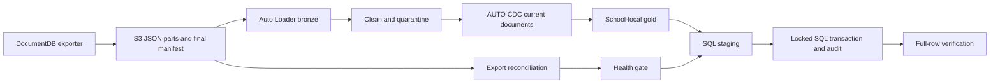
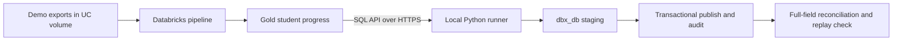

# Databricks DLT student-events pipeline

[](https://github.com/visuvishwa99/Databricks-dlt/actions/workflows/ci.yml)

## Business problem

A student-learning app exports activity documents as immutable JSON files. District reporting needs completions by each school's local day, while a teacher-facing PostgreSQL app needs each student's latest progress. This project builds a checked path from export to analytics and an atomic PostgreSQL publication step, including failure handling for incomplete files and job retries.

This is a **personal, synthetic portfolio project**, not work delivered for Lexia Learning or an employer. The [simulated business scenarios](docs/business-problems.md) are learning exercises, and [evidence](docs/evidence.md) records what was actually run.



**Stack:** Databricks Asset Bundles, Lakeflow Declarative Pipelines, Auto Loader, Unity Catalog, PySpark, Delta tables, GitHub Actions, and PostgreSQL 18. SQL Server code remains as a legacy reference. The demo uses a managed Unity Catalog volume; full environments require S3, school Federation, and a JDBC route.

## Start here

| Goal | Read / run |
| --- | --- |
| Understand the system and tradeoffs | [Architecture and ADRs](docs/architecture.md) |
| Learn source and consumer semantics | [Data contract](docs/data-contract.md) |
| Deploy into another workspace | [Deployment and CI/CD](docs/deployment.md) |
| Operate, tune, alert and recover | [Operations runbook](docs/operations.md) |
| Prepare infrastructure and access | [Security and infrastructure](docs/security-and-infrastructure.md) |
| Prepare for interviews | [Interview guide: walkthrough, questions, drills and rubric](docs/interview-guide.md) |
| See what was actually verified | [Evidence and release gates](docs/evidence.md) |
| Explore simulated business cases | [Business problems and drills](docs/business-problems.md) |
| Review student deletion requirements | [Deletion design](docs/data-deletion.md) |

## Implemented controls

- Explicit Extended JSON schema, tolerant timestamp parsing, quarantine reason codes and fail/drop/warn expectations.
- Source completeness reconciliation, empty heartbeat handling, freshness and quarantine publication gates.
- SCD1 current documents, source revision conflict detection and timezone-aware business aggregates.
- SQL staging isolated by run/attempt, expected-count checks, duplicate retry handling, transaction lock, stale-snapshot fencing, audit-based replay, guarded deletion and full-field verification.
- Host-independent Databricks bundle with demo/dev/prod targets, production runtime principal, bounded retries/timeouts, failure notification configuration and paused schedules.
- GitHub Actions with pinned tools/actions, Spark tests, PostgreSQL and legacy SQL Server failure tests, OIDC deployment and environment preflight.
- Synthetic export generator, reusable workspace smoke check, monitoring queries, recovery/rollback procedures and interview exercises.

## Create Databricks secrets for local PostgreSQL

The local database **`dbx_db`** has been created on Windows PostgreSQL 18 at
`localhost:5432`, and a connection as `postgres` has been verified. The dev/prod publishing jobs now target PostgreSQL. Creating secrets does not
connect cloud compute to your laptop; the verified local path uses outbound SQL API access.

### 1. Sign in to the intended workspace

Run these commands in your own PowerShell terminal:

```powershell
databricks auth login --host https://dbc-7f4188e4-3fd1.cloud.databricks.com --profile LEXIA
databricks current-user me --profile LEXIA
databricks secrets list-scopes --profile LEXIA
```

For another environment, use that workspace's host and a separate profile.
Scopes and values must be configured in each workspace.

### 2. Create the administrator scope once

```powershell
databricks secrets create-scope postgres_local_admin --profile LEXIA
```

This scope already exists in the current workspace; skip creation there.
Keep its access limited to database provisioning administrators.

### 3. Enter the existing PostgreSQL password

```powershell
databricks secrets put-secret postgres_local_admin password --profile LEXIA
```

Enter the password for your local PostgreSQL administrator (normally `postgres`)
when prompted, then press Enter. Use the interactive prompt rather than a password
in command arguments, chat, a notebook cell, or a committed file. This stores the
existing password; it does not change the PostgreSQL login password.

**Git Bash on Windows:** if the CLI waits without displaying a prompt, cancel it
with Ctrl+C and use this block. Bash handles hidden input and pipes the value to
the CLI, closing standard input when finished:

```bash
read -rsp "PostgreSQL password: " pg_password
echo
printf '%s' "$pg_password" | databricks secrets put-secret postgres_local_admin password --profile LEXIA
unset pg_password
```

If database creation reports `password authentication failed`, the secret was
stored but PostgreSQL rejected the credentials. Confirm the administrator username
and enter that login's existing PostgreSQL password again; this is not your
Databricks or Windows password.

### 4. Verify the key without displaying its value

```powershell
databricks secrets list-secrets postgres_local_admin --profile LEXIA
databricks secrets list-acls postgres_local_admin --profile LEXIA
```

The key list should include `password`. This verifies storage, not database
authentication. Do not print or decode the secret to check it.

### 5. Create the database locally

From the repository root, the following command prompts for the PostgreSQL admin
password and runs the idempotent database creation script:

```powershell
& 'C:\Program Files\PostgreSQL\18\bin\psql.exe' -X -W -h localhost -p 5432 -U postgres -d postgres -f sql/create_postgres_database.sql
```

The script preserves an existing `dbx_db`. Substitute your administrator username
if it is different. This command creates the database only; application tables,
restricted logins, and PostgreSQL publishing routines are a separate migration.

### 6. Separate application credentials from administrator credentials

The setup script provisions restricted application and maintenance logins and their
scopes automatically. For manual setup in another workspace, create separate
scopes and enter their respective values using interactive prompts:

```powershell
databricks secrets create-scope sis_postgres --profile LEXIA
databricks secrets create-scope sis_postgres_maintenance --profile LEXIA
databricks secrets put-secret sis_postgres user --profile LEXIA
databricks secrets put-secret sis_postgres password --profile LEXIA
databricks secrets put-secret sis_postgres_maintenance user --profile LEXIA
databricks secrets put-secret sis_postgres_maintenance password --profile LEXIA
```

When the job identity is known, grant it `READ` on only its runtime scope:

```powershell
databricks secrets put-acl sis_postgres '<job-service-principal-application-id>' READ --profile LEXIA
```

Replace the placeholder before running. Do not grant the runtime identity access
to `postgres_local_admin`. A notebook or job reads a value without logging it:

```python
password = dbutils.secrets.get(scope="sis_postgres", key="password")
```

Cloud Databricks needs a reachable network endpoint and verified TLS to access
your Windows database. `localhost` inside Databricks refers to its own compute,
not your computer. Configure the cloud endpoint after a private
network route is ready; never reuse the current SQL Server JDBC configuration.

To rotate a secret, rerun `put-secret` for its existing scope and key after
coordinating the corresponding database password change. Restart affected clients
and verify authentication. See [Databricks secret management](https://docs.databricks.com/aws/en/security/secrets/).

## PostgreSQL end-to-end run

The local integration uses this path:



The runner initiates all connections from your computer. It does not expose a
PostgreSQL port publicly. Keep the machine online during a run. This is a manual
hybrid demonstration, not an unattended cloud production deployment.

### Install and provision

```powershell
python -m pip install -r requirements-postgres.txt
python scripts/setup_local_postgres.py --profile LEXIA
```

The setup script applies `sql/postgres_setup.sql` in `dbx_db`, creates a non-login
object owner and restricted `dbx_publisher` and `dbx_maintenance` logins, and stores
generated passwords in `sis_postgres` and `sis_postgres_maintenance`. The admin
password stays in `postgres_local_admin`. Re-running preserves generated passwords.
Use this provisioning script only for the dedicated local development database.

### Run the complete demo

```powershell
python scripts/run_local_postgres_e2e.py --profile LEXIA --warehouse-id d08c221c286f4b39 --job-id 250557649698066 --max-quarantine-rows 2 --output .generated/postgres-e2e.json
```

The command refreshes the pipeline, waits for success, checks export completeness,
CDC conflicts and quarantine count, retrieves a bounded Gold snapshot, stages it,
publishes atomically, verifies every field, and retries the same run to verify
idempotency. The two permitted quarantine rows are the existing malformed-input
drill. Fixed historical samples do not pass a production freshness SLA; the demo
runner explicitly omits that check. The full cloud workflow retains its health gate.

The runner rejects empty, duplicate-key, oversized, incomplete and truncated
results. Its default limit is 100,000 rows; it is not a high-volume transport.
Deletions are disabled by default. Concurrent publishers serialize under a
transaction advisory lock and stale snapshots fail.

### Verified result

The [recorded end-to-end run](docs/postgres-e2e-evidence.json) passed on October 23,
2026 (America/Phoenix): pipeline run `981715506262947`, **2 published rows**, full-field
reconciliation and replay passed, **0 failed exports**, **0 CDC conflicts**, and
**2 expected quarantine rows**. Evidence timestamps use UTC. The PostgreSQL
transaction suite also passed locally; details are in [evidence](docs/evidence.md).

### Retention and access

- `stg.student_progress`: isolated run/attempt staging.
- `serving.student_progress`: current serving snapshot.
- `serving.publish_audit`: durable replay and reconciliation evidence.
- Publisher: stage inserts and function execution; no direct serving-table writes.
- Maintenance: cleanup function only; no direct table deletion.
- Cleanup removes expired orphan attempts and older reconciled snapshots, preserves
  the latest snapshot and all unreconciled successful attempts, and retains audit rows.

### Cloud deployment and CI

The dev/prod bundle uses the PostgreSQL JDBC driver for distributed staging and
Psycopg for transaction functions, reconciliation and cleanup. These jobs require
a private route, a hostname covered by the server certificate, and a trusted CA
file on compute. Set `host`, `port`, `database`, `user`, `password`, and
`sslrootcert` in each environment's runtime secret scope. Cloud code enforces
`sslmode=verify-full`. Local loopback mode is available only in the local runner.

The demo bundle remains a pipeline-only refresh job; the local runner orchestrates
its PostgreSQL follow-up. No cloud JDBC connection to this laptop is claimed.
GitHub Actions includes a PostgreSQL 18 integration job with a generated temporary
password and disposable test databases. Existing SQL Server tests cover the legacy
implementation. The PostgreSQL tests exercise replay, null/case/space corrections,
rollback guards, deletion thresholds, retention and reconciliation failure.

## Run tests

Use Python 3.11 and Java 17 in a clean virtual environment:

```shell
python -m pip install -r requirements-dev.txt
ruff check .
python -m pytest tests --ignore=tests/integration -q
```

SQL integration tests run in GitHub Actions against an ephemeral SQL Server 2022 instance. The test database is created and removed per test; never point that harness at a production database. See [the workflow](.github/workflows/ci.yml).

## Run the demo

```shell
databricks bundle validate -t demo -p LEXIA --strict
databricks bundle plan -t demo -p LEXIA
databricks bundle deploy -t demo -p LEXIA
databricks bundle run -t demo -p LEXIA student_events_refresh
```

The supplied workspace already contains the synthetic sample and a two-row quarantine drill. A new deployment must upload each part file before its manifest; commands are in the deployment guide. The demo deliberately omits external SQL Server/Federation and the fixed sample's freshness gate.

- [Live pipeline](https://dbc-7f4188e4-3fd1.cloud.databricks.com/pipelines/070eddb6-9b00-4850-9bea-2a1e83f06755?o=7474652460637329)
- [Successful malformed-input drill](https://dbc-7f4188e4-3fd1.cloud.databricks.com/jobs/250557649698066/runs/829586113643927?o=7474652460637329)
- [GitHub Actions](https://github.com/visuvishwa99/Databricks-dlt/actions)

Workspace links require access to the demonstration workspace. The portable [evidence record](docs/evidence.md) includes run IDs, test results, and pending gates.

## Verify data and generate exercises

```shell
python scripts/smoke_test.py --warehouse-id YOUR_WAREHOUSE --catalog workspace --schema default --profile LEXIA --expected-current-rows 2 --max-quarantine-rows 2
python scripts/generate_export.py --run-id exercise-001 --rows 10000 --rows-per-file 1000
```

The smoke query uses SQL warehouse compute. Generated data belongs in an isolated exercise prefix/schema. Never overwrite an existing export folder. Use a fixed event time and increasing revision for correction/replay experiments.

## Production boundaries

The full dev/prod workflow needs an S3 external location, source contract, federated school table, dedicated JDBC compute, secret scope, SQL migration, service principals and GitHub environment settings. Automatic dev deployment is disabled until the repository variable ENABLE_AUTO_DEV is true; manual deployment still validates all settings. Prod must use main and should have a protected environment. A deployment leaves schedules paused.

The v1 source contract does not support physical source deletes or partial update images. Gold can be partially refreshed when a pipeline fails; direct BI consumers needing atomic publication require a separate approved snapshot layer. File counts do not replace source reconciliation or checksums. SLOs, peak capacity, regulatory controls and disaster recovery are release gates, not claims established by the small demo.

For interviews, start with the guide, run the drills, and explain the verified results and limits in your own words.

## Key design decisions

- [Triggered ingestion and immutable bronze](docs/architecture.md#adr-1-triggered-file-ingestion-instead-of-continuous-processing)
- [Source-ordered AUTO CDC](docs/architecture.md#adr-3-scd1-auto-cdc)
- [Fail-closed quality and publication gates](docs/architecture.md#adr-4-separate-failure-policies)
- [Atomic SQL Server publication](docs/architecture.md#adr-5-sql-publication-protocol)

The current publication contract is a **full snapshot**. An incremental SQL mode needs a separately tested change-batch and deletion protocol; staging changed keys into the current procedure would be unsafe. Scale and cost numbers will be published only after representative runs, with input cardinality and workspace billing evidence.
