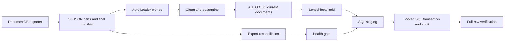

# Databricks DLT student-events pipeline

[](https://github.com/visuvishwa99/Databricks-dlt/actions/workflows/ci.yml)

## Business problem

A student-learning app exports activity documents as immutable JSON files. District reporting needs completions by each school's local day, while a teacher-facing SQL Server app needs each student's latest progress. This project builds a checked path from export to analytics and an atomic SQL Server publication step, including failure handling for incomplete files and job retries.

This is a **personal, synthetic portfolio project**, not work delivered for Lexia Learning or an employer. The [simulated business scenarios](docs/business-problems.md) are learning exercises, and [evidence](docs/evidence.md) records what was actually run.



**Stack:** Databricks Asset Bundles, Lakeflow Declarative Pipelines, Auto Loader, Unity Catalog, PySpark, Delta tables, GitHub Actions, and SQL Server. The demo uses a managed Unity Catalog volume; full environments require S3, school Federation, and a JDBC route.

## Start here

| Goal | Read / run |
| --- | --- |
| Understand the system and tradeoffs | [Architecture and ADRs](docs/architecture.md) |
| Learn source and consumer semantics | [Data contract](docs/data-contract.md) |
| Deploy into another workspace | [Deployment and CI/CD](docs/deployment.md) |
| Operate, tune, alert and recover | [Operations runbook](docs/operations.md) |
| Prepare infrastructure and access | [Security and infrastructure](docs/security-and-infrastructure.md) |
| Prepare for interviews | [Interview guide: walkthrough, questions, drills and rubric](docs/interview-guide.md) |
| See what was actually verified | [Evidence and release gates](docs/evidence.md) |
| Explore simulated business cases | [Business problems and drills](docs/business-problems.md) |
| Review student deletion requirements | [Deletion design](docs/data-deletion.md) |

## Implemented controls

- Explicit Extended JSON schema, tolerant timestamp parsing, quarantine reason codes and fail/drop/warn expectations.
- Source completeness reconciliation, empty heartbeat handling, freshness and quarantine publication gates.
- SCD1 current documents, source revision conflict detection and timezone-aware business aggregates.
- SQL staging isolated by run/attempt, expected-count checks, duplicate retry handling, transaction lock, stale-snapshot fencing, audit-based replay, guarded deletion and full-field verification.
- Host-independent Databricks bundle with demo/dev/prod targets, production runtime principal, bounded retries/timeouts, failure notification configuration and paused schedules.
- GitHub Actions with pinned tools/actions, Spark tests, SQL Server failure tests, OIDC deployment and environment preflight.
- Synthetic export generator, reusable workspace smoke check, monitoring queries, recovery/rollback procedures and interview exercises.

## Run tests

Use Python 3.11 and Java 17 in a clean virtual environment:

```shell
python -m pip install -r requirements-dev.txt
ruff check .
python -m pytest tests --ignore=tests/integration -q
```

SQL integration tests run in GitHub Actions against an ephemeral SQL Server 2022 instance. The test database is created and removed per test; never point that harness at a production database. See [the workflow](.github/workflows/ci.yml).

## Run the demo

```shell
databricks bundle validate -t demo -p LEXIA --strict
databricks bundle plan -t demo -p LEXIA
databricks bundle deploy -t demo -p LEXIA
databricks bundle run -t demo -p LEXIA student_events_refresh
```

The supplied workspace already contains the synthetic sample and a two-row quarantine drill. A new deployment must upload each part file before its manifest; commands are in the deployment guide. The demo deliberately omits external SQL Server/Federation and the fixed sample's freshness gate.

- [Live pipeline](https://dbc-7f4188e4-3fd1.cloud.databricks.com/pipelines/070eddb6-9b00-4850-9bea-2a1e83f06755?o=7474652460637329)
- [Successful malformed-input drill](https://dbc-7f4188e4-3fd1.cloud.databricks.com/jobs/250557649698066/runs/829586113643927?o=7474652460637329)
- [GitHub Actions](https://github.com/visuvishwa99/Databricks-dlt/actions)

Workspace links require access to the demonstration workspace. The portable [evidence record](docs/evidence.md) includes run IDs, test results, and pending gates.

## Verify data and generate exercises

```shell
python scripts/smoke_test.py --warehouse-id YOUR_WAREHOUSE --catalog workspace --schema default --profile LEXIA --expected-current-rows 2 --max-quarantine-rows 2
python scripts/generate_export.py --run-id exercise-001 --rows 10000 --rows-per-file 1000
```

The smoke query uses SQL warehouse compute. Generated data belongs in an isolated exercise prefix/schema. Never overwrite an existing export folder. Use a fixed event time and increasing revision for correction/replay experiments.

## Production boundaries

The full dev/prod workflow needs an S3 external location, source contract, federated school table, dedicated JDBC compute, secret scope, SQL migration, service principals and GitHub environment settings. Automatic dev deployment is disabled until the repository variable ENABLE_AUTO_DEV is true; manual deployment still validates all settings. Prod must use main and should have a protected environment. A deployment leaves schedules paused.

The v1 source contract does not support physical source deletes or partial update images. Gold can be partially refreshed when a pipeline fails; direct BI consumers needing atomic publication require a separate approved snapshot layer. File counts do not replace source reconciliation or checksums. SLOs, peak capacity, regulatory controls and disaster recovery are release gates, not claims established by the small demo.

For interviews, start with the guide, run the drills, and explain the verified results and limits in your own words.

## Key design decisions

- [Triggered ingestion and immutable bronze](docs/architecture.md#adr-1-triggered-file-ingestion-instead-of-continuous-processing)
- [Source-ordered AUTO CDC](docs/architecture.md#adr-3-scd1-auto-cdc)
- [Fail-closed quality and publication gates](docs/architecture.md#adr-4-separate-failure-policies)
- [Atomic SQL Server publication](docs/architecture.md#adr-5-sql-publication-protocol)

The current publication contract is a **full snapshot**. An incremental SQL mode needs a separately tested change-batch and deletion protocol; staging changed keys into the current procedure would be unsafe. Scale and cost numbers will be published only after representative runs, with input cardinality and workspace billing evidence.
