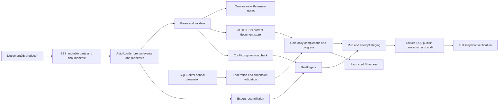

# Architecture and decisions

## Business problem and boundary

An education application exports MongoDB DocumentDB student events to S3. Analysts need daily completions by a school's local date, and an operational SQL Server application needs each student's current progress. The export producer is an external dependency: this repository starts at immutable JSON files, not the DocumentDB transaction log. Its latency includes the export cadence.

## Data grains

| Dataset | Grain | Key / meaning |
| --- | --- | --- |
| bronze_student_events | One received source row | Retains every exported occurrence and file provenance |
| bronze_export_manifests | One marker occurrence | run_id; duplicates fail reconciliation |
| silver_student_events_clean | Accepted source occurrence | Still includes repeated exports of a document |
| silver_quarantine_events | Rejected source occurrence | quality_errors explains failed business predicates |
| silver_student_events | Current source document | MongoDB _id, SCD type 1 |
| silver_school_dim | School | school_id; contradictory metadata fails |
| gold_daily_completions | Product, school, grade, local day, change type | Count of current completed documents, distinct students |
| gold_student_progress | Product and student | Current school/latest unit and level; completion count |
| ops_export_reconciliation | Export run | Manifest vs observed file and row counts |
| ops_cdc_conflicts | Document and update timestamp | Conflicting business payloads; must remain empty |
| SQL staging v2 | Attempt, run, business key, payload | Duplicate identical JDBC writes tolerated |
| SQL serving | Product and student | Last successfully published complete snapshot |

Completion means a document whose is_completed is true. It is **not automatically a unique unit completion**. ActivityCompleted and UnitCompleted events can both contribute. Confirm that semantic with product owners before interpreting counts. The latest school is attached to student progress; daily facts use the school on the event. School name/time-zone changes can restate historical gold because the dimension is current-state, not SCD2.

## ADR 1: Triggered file ingestion instead of continuous processing

The producer already exports files. Triggered Auto Loader fits that boundary and avoids paying for an always-on pipeline between exports. Default full jobs are scheduled every 15 minutes in configured school hours but remain paused. A sub-minute SLA would require revisiting the producer, transport, and continuous compute together. Files alone cannot reveal a source record the exporter silently omitted; source-to-export reconciliation belongs to the producer.

## ADR 2: Bronze retention and explicit schema

Explicit Extended JSON schemas make malformed values observable. Unknown/type-mismatched fields are rescued and rejected from clean data. Syntactically broken JSON fails ingestion; the original S3 object is the replay record. Bronze full refresh is disabled to avoid accidentally destroying the replay boundary. Producer files are immutable; reusing a file path is forbidden. CloudFiles checkpoint progress handles file discovery; source timestamps and CDC handle repeated documents across distinct files. Neither is a distributed exactly-once guarantee across SQL Server.

## ADR 3: SCD1 AUTO CDC

The requirement is current document state. AUTO CDC handles out-of-order arrival using the source updated_at followed by exported_at and source_file. The latter two fields make delivery ordering deterministic but cannot infer source truth when two different payloads share one source timestamp. A materialized conflict gate detects that producer contract violation across accepted history and fails the update. This scan grows with history; an authoritative source revision would be preferable at scale. Missing updated_at in v1 falls back to attempt time, so immutable append-only documents are safe; mutable documents must carry authoritative updated_at.

Exact duplicate exports do not create additional current rows. Corrections can decrease aggregates. Physical DocumentDB deletes are not represented by this contract and are **not propagated**. A delete-enabled v2 contract needs tombstones, source sequencing, CDC delete handling, retention, privacy controls, and migration tests. Do not infer deletes from a missing document in an incremental export. A content hash detects conflicting payloads; it does not tell which payload is newer.

## ADR 4: Separate failure policies

Missing document identity or unknown schema version stops the clean flow. Invalid business fields and rescued data go to quarantine with reasons. Quality thresholds then decide whether serving may publish. Manifest/count disagreements block publication immediately; a paging grace period must not permit partial serving data. Pipelines do not provide an atomic transaction across every table: a failed update can leave some refreshed tables visible. Restrict direct gold consumers accordingly; strict BI publication requires a separately versioned, approved gold snapshot/view, which is a release gate for such consumers.

## ADR 5: SQL publication protocol

1. Capture gold once and cache that snapshot. Record a UTC snapshot start time and expected row count.
2. Append to a unique (run_id, attempt_id) staging partition, limiting JDBC parallelism to four by default.
3. In SQL Server, take a transaction-owned application lock. An already audited run is an idempotent no-op.
4. Reject older snapshot times, empty/partial snapshots and contradictory business keys. Collapse identical rows introduced by executor retries.
5. Reject removals unless explicitly enabled and within the configured deletion fraction.
6. Update/insert/delete serving rows and append the audit in one transaction. Roll back everything on error.
7. Compare every serving field with the retained published attempt using multiset differences in both directions.

There is no cross-system transaction spanning Delta and SQL Server. SQL staging is at least once; final publication is idempotent per run ID and atomic within SQL Server. The stale-snapshot fence assumes synchronized driver clocks; a source-issued monotonic snapshot revision is stronger. A crash after commit is resolved by the SQL audit. Orphan staging attempts are harmless but require retention cleanup. Job max_concurrent_runs=1 coordinates normal runs; the database lock also protects against independent publishers. External writers to serving are prohibited by permissions.

## ADR 6: Bundle and promotion

One bundle defines demo/dev/prod. Hosts and data dependencies come from profiles or GitHub environments. Production uses a runtime service principal. GitHub test jobs have no Databricks token permissions; the deployment job uses OIDC and requires both test jobs. Production is restricted to main and should require environment approval. Deployment does not run data by default or unpause schedules. Catalogs/schemas must also be isolated when workspaces share a metastore.

## Deliberate limits

S3/IAM, DocumentDB export, network connectivity, Federation setup, cluster/JDBC installation, account federation policies, BI governance, paging routing and backups are external prerequisites. The repository is application code plus deployment automation, not a complete cloud landing zone. Scaling thresholds and SLOs in operations.md are proposed targets until measured under representative load.

## Primary references

- [AUTO CDC sequencing and APIs](https://docs.databricks.com/aws/en/ldp/cdc)
- [Auto Loader production considerations](https://docs.databricks.com/aws/en/ingestion/cloud-object-storage/auto-loader/production)
- [Schema evolution and rescued data](https://docs.databricks.com/aws/en/ingestion/cloud-object-storage/auto-loader/schema)
- [SQL Server application locks](https://learn.microsoft.com/en-us/sql/relational-databases/system-stored-procedures/sp-getapplock-transact-sql)
